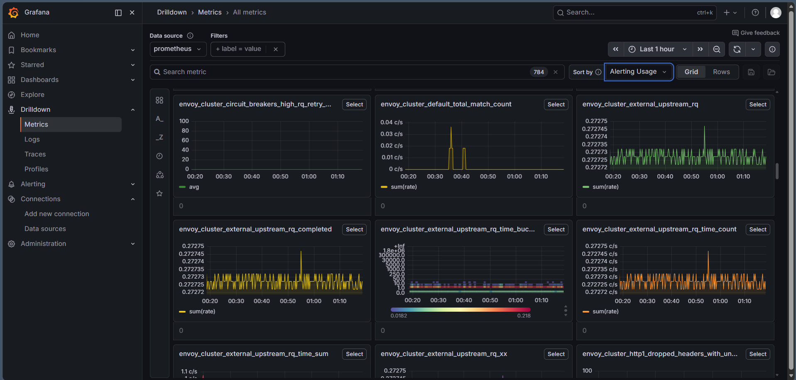
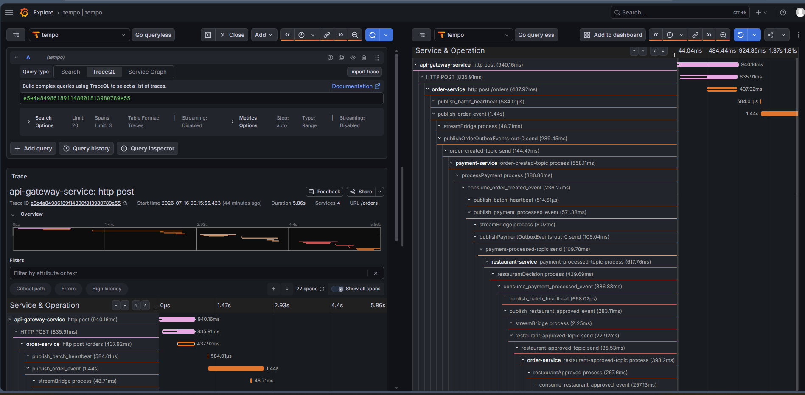
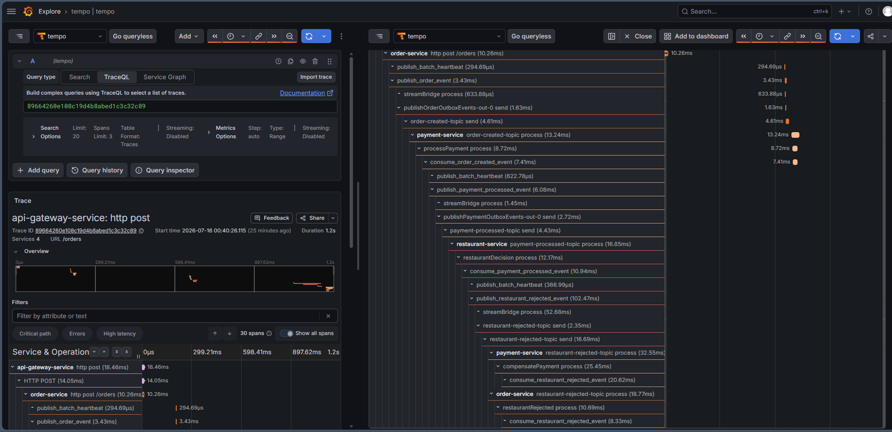
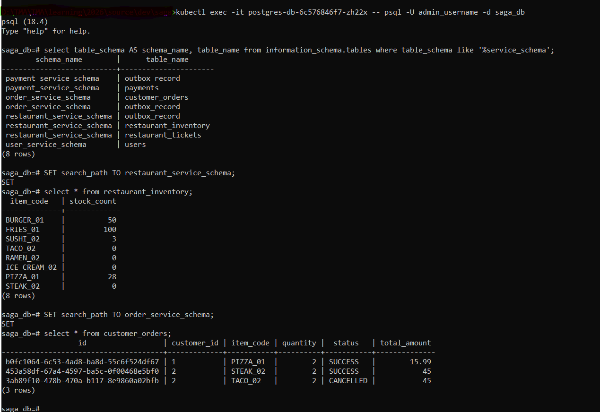

# 📊 Observability Ops & Grafana Triage Manual

This playbook defines the production-grade triage procedures, search strategies, and debugging loops used to monitor distributed transactions and ensure total data schema separation inside the cluster.

---

## 🔬 1. Inbound/Outbound Network Proxy Audit

Open the Grafana **Drilldown** interface and select your **Prometheus** data source (Web Administrative Interface Port: `9095`). Search for `envoy_cluster` metrics to inspect your sidecarless Envoy proxy traffic shapes directly from the kernel space. Use this dashboard view to isolate hidden downstream connection retries, dropped proxy headers, or active circuit breaker trips.

*   **Circuit Breakers & Retries:** Track spikes on `envoy_cluster_circuit_breakers_high_rq_retry...` to diagnose downstream microservice exhaustion.
*   **Request Latency & Rates:** Audit `envoy_cluster_external_upstream_rq_time_count` to detect trailing anomalies across upstream cluster scopes.



---

## 🔍 2. Distributed Trace Inspection Playbook

Open the Grafana Explore interface and target the **Loki 3.x** and **Tempo** data sources. Click the **Split Window (`| Split`)** button in the upper-right corner of the interface. Keep your search metadata inputs on the left pane while maximizing the timeline waterfall panel layout on the right pane to examine distributed traces across microservice boundaries.

### 🟢 Profile A: The Synchronized Happy Flow Path
When an order cleanly executes, the trace cascade down the timeline displays an unfragmented, synchronous waterfall of `http` and `grpc` spans across all participating services with no error flags.

1.  **Execute Ingress Request**: Dispatch a valid payload through the edge proxy loop:
    ```bash
    curl -X POST http://localhost:8080/orders \
      -H "Authorization: Bearer <your-jwt-token>" \
      -H "Content-Type: application/json" \
      -d '{"customerId":"1","totalAmount":15.99,"itemCode":"PIZZA_01","quantity":2}'
    ```
2.  **Extract Trace ID via Loki**: Grab the generated `id` from the HTTP response payload and query your logs to locate the structural transaction tracking string:
    ```logql
    {service_name="order-service"} |= "INSERT_YOUR_ORDER_ID_HERE"
    ```
3.  **Analyze Timeline Waterfall**: Input the recovered string identifier into the right-hand Tempo pane. Look for the seamless handover from `api-gateway-service` ➔ `order-service` ➔ `payment-service` ➔ `restaurant-service`, terminating in an asynchronous loop back to the orchestrator to mark the transaction state as `SUCCESS`.



### 🔴 Profile B: Mid-Flight Asynchronous Saga Compensation Workflow
When a business constraint fails downstream (e.g., a low-stock deficit or a ledger allocation bounce), the timeline dynamically records the interruption, highlighting active exceptions and the firing of compensating reverse-transactions.

1.  **Simulate Core Business Failure**: Dispatch a request engineered to breach inventory stocks:
    ```bash
    curl -X POST http://localhost:8080/orders \
      -H "Authorization: Bearer <your-jwt-token>" \
      -H "Content-Type: application/json" \
      -d '{"customerId":"1","totalAmount":9999.99,"itemCode":"OUT_OF_STOCK_ITEM","quantity":1}'
    ```
2.  **Isolate Failure Session via Loki**: Locate the error session record using the failed order identifier:
    ```logql
    {service_name="order-service"} |= "INSERT_YOUR_FAILED_ORDER_ID_HERE"
    ```
3.  **Trace Rollback Cascades**: Observe the explicit red error highlight block on the downstream span (`StatusCode.ERROR`), immediately followed by a compensating outbox event loop tracking back upstream (`compensatePayment process` on `payment-service`). Confirm that the transaction state safely rolls back to `CANCELLED` on the `order-service` timeline.



---

## 💾 3. PostgreSQL Segregated Engine Storage Audit

Verify data isolation boundaries and transactional states directly inside the database cluster engine to ensure each microservice mutates data only within its designated schema scope without causing cross-domain boundary clashing.

### Step 1: Connect to the Database Pod Engine
Execute into the active PostgreSQL container using `kubectl` and launch the interactive `psql` shell terminal interface:
```bash
kubectl exec -it postgres-db-65998f55bc-fgrcd -n saga-ecosystem -- psql -U postgres -d saga_db
```

### Step 2: Verify Isolated Service Schemas
Run this specific meta-query against your active prompt to confirm that microservice tables are safely partitioned inside their respective schema boundaries:
```sql
SELECT 
    table_schema AS schema_name, 
    table_name 
FROM 
    information_schema.tables 
WHERE 
    table_schema IN ('order_service_schema', 'payment_service_schema', 'restaurant_service_schema', 'user_service_schema')
ORDER BY 
    table_schema, table_name;
```

**Expected Catalog Isolation Layout:**
```text
        schema_name         |       table_name       
----------------------------+------------------------
 order_service_schema       | customer_orders
 order_service_schema       | outbox_record
 payment_service_schema     | outbox_record
 payment_service_schema     | payments
 restaurant_service_schema  | outbox_record
 restaurant_service_schema  | restaurant_inventory
 restaurant_service_schema  | restaurant_tickets
 user_service_schema        | users
(8 rows)
```

### Step 3: Inspect Distributed Business State Changes
Switch search paths manually to target individual domain spaces to verify downstream inventory balances and final transactional processing states.

*   **Audit Restaurant Stock Constraints:**
    ```sql
    SET search_path TO restaurant_service_schema;
    SELECT * FROM restaurant_inventory;
    ```
*   **Audit Finalized Order Ledger States:**
    ```sql
    SET search_path TO order_service_schema;
    SELECT * FROM customer_orders;
    ```

**Expected State Verification Output Matrix:**
```text
                  id                  | customer_id | item_code | quantity |   status  | total_amount 
--------------------------------------+-------------+-----------+----------+-----------+--------------
 b0fc1064-6c53-4ad8-ba8d-55c6f524df67 | 1           | PIZZA_01  |        2 | SUCCESS   |        15.99
 e4da2189-2b41-4cf2-ac2b-66d7f315cb12 | 1           | TACO_02   |        1 | CANCELLED |         8.50
```


